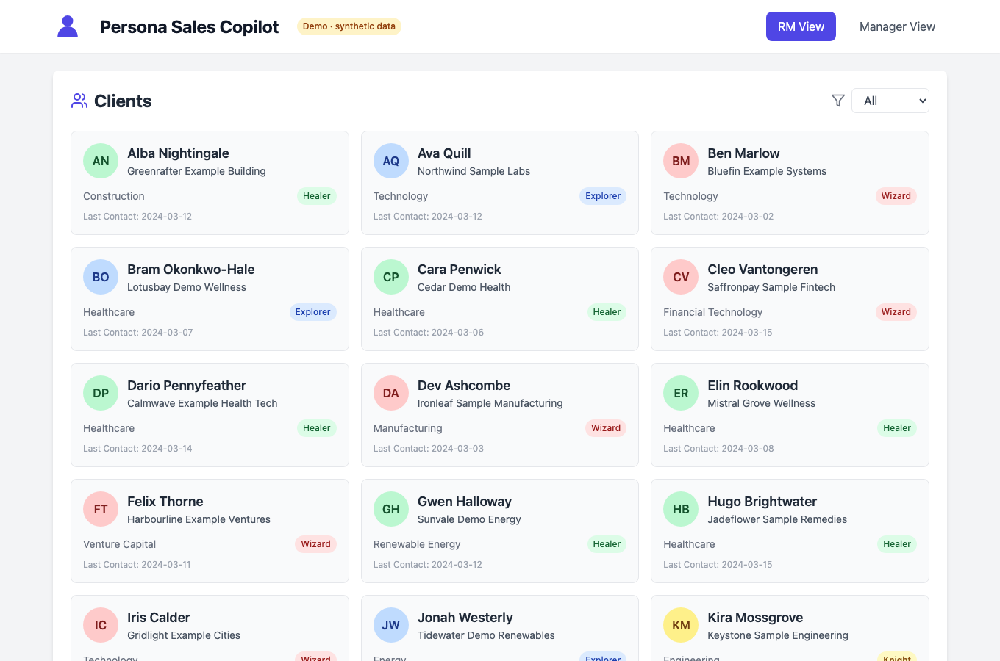
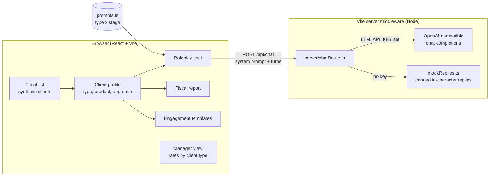
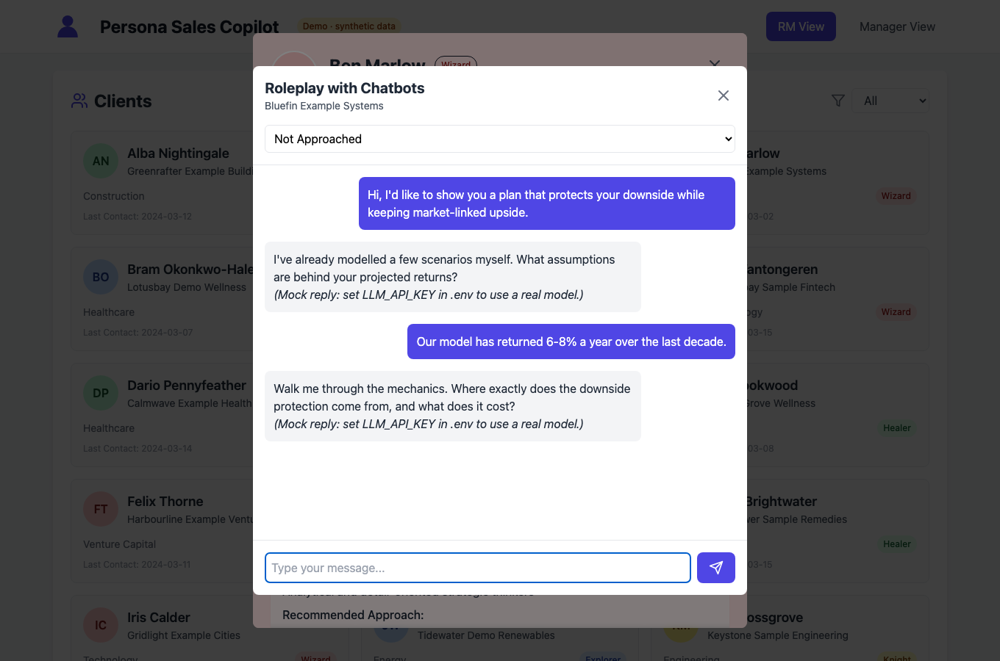
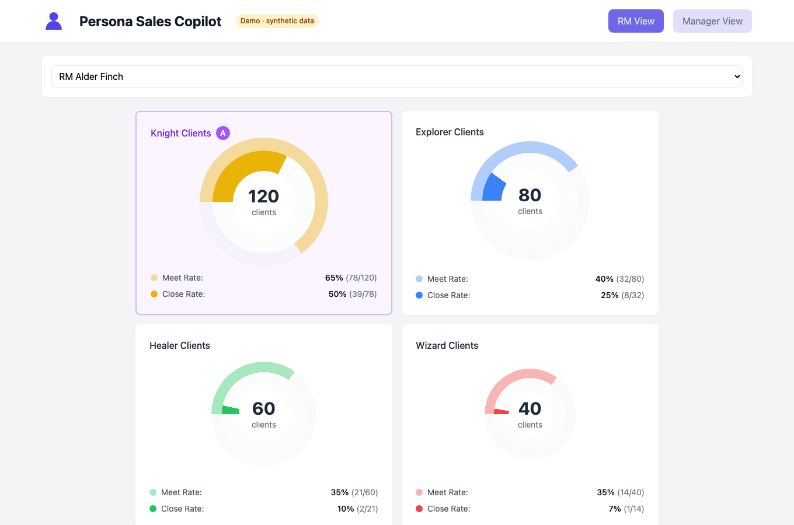

# persona-sales-copilot

A sales-copilot demo for bank relationship managers: each client carries a persona type, and the app turns that type into a recommended product, a roleplay partner to practise on, a talking-point report and outreach templates.

Built while CTO of Mindreader, on Mindreader's persona framework, the Human Intelligence System (HIS). It was used in pitches to banks and insurers. This public version uses synthetic data only.



## The problem

A relationship manager at a bank or insurer may carry a few hundred clients. The product shelf is the same for all of them, but the way to open, what to emphasise and what to avoid differ a lot from client to client. A pitch that works on a numbers-first client loses a values-first one. Managers can see who closes and who doesn't, but not why, or with which kind of client.

## Approach

HIS sorts people into four temperament types, adapted from David Keirsey's temperament model: **Knight**, **Explorer**, **Healer** and **Wizard**. The demo assumes each client already has a type (in Mindreader's product that came from a quiz or a model) and builds every screen around it:

- **Client list** filtered by type, with a profile per client: demographics, the recommended product for that type, and the recommended approach and pain points.
- **Roleplay practice.** An LLM plays the client, in character for their type and for the current sales stage (Not Approached, Opening Appointment, Closing Appointment, Done Deal). The RM practises the pitch before the real meeting.
- **Fiscal report.** A per-client report preview: investing strengths and blind spots for their type, a portfolio overview and a recommended solution, meant as a conversation starter.
- **Client engagement.** Visual, WhatsApp and email templates written in the language each type responds to.
- **Manager view.** For each RM, meeting and close rates split by client type, with coaching points and red flags. It shows, for example, an RM who closes half their Knight meetings but few Wizard ones.



The roleplay prompt is two parts: a base persona prompt for the type (how this client talks, what they distrust, what they need to hear) and a stage prompt (for example, a Wizard at the closing appointment "needs clear metrics for success" and is "a very difficult client to close"). Changing the stage resets the conversation with the new prompt.

## Results

This repo is a demo, not a measured deployment, so it has no results of its own. Mindreader's published numbers (users, the face-model test against third-party personality tests, advisor testimonials) are on the [Mindreader work page](https://tonytonggg.com/work/mindreader).

## Screenshots

| Roleplay (mock replies, no key) | Manager view |
| --- | --- |
|  |  |

## Quickstart

Needs Node 18 or later.

```bash
npm install
npm run dev          # http://localhost:5173
```

The roleplay works without a key: the server route answers with canned in-character replies, marked as mock. To use a real model:

```bash
cp .env.example .env
# set LLM_API_KEY (and optionally LLM_MODEL, LLM_BASE_URL for any OpenAI-compatible endpoint)
npm run dev
```

Production build and local preview (the chat route runs in `vite preview` too):

```bash
npm run build
npm run preview      # http://localhost:4173
npm run typecheck
npm run lint
npm test             # vitest, no key or network needed
```

The tests cover the persona logic (client filtering, the prompt for each type and stage, the manager-view funnel rates), the chat route's mock and keyed paths with a stubbed `fetch`, and a production build made with a sentinel `LLM_API_KEY` in the environment, which must not appear in the bundle.

## Repo layout

```
server/
  chatRoute.ts        POST /api/chat as Vite dev/preview middleware; holds the LLM key
  mockReplies.ts      canned replies per type when no key is set
src/
  App.tsx             RM view / Manager view switch
  components/         ClientList, ClientDetails, RoleplayModal, FiscalReportModal,
                      FacebookAdsModal (engagement templates), ManagerDashboard, Avatar
  constants/prompts.ts  roleplay prompts: 4 types x 4 sales stages
  data/               SYNTHETIC clients, RM pipeline stats, products, type traits, marketing copy
  lib/persona.ts      pure logic: client filter, roleplay prompt, funnel rates, initials
  types/              shared TypeScript types
test/                 vitest: persona logic, chat route, no key in the client bundle
docs/screenshots/     README images
```

## Design decisions and honest notes

- **Demo-grade.** Everything is static and in memory: no database, no auth, no CRM sync. Buttons such as "Download Personalised Report" and "Send Message Template" are placeholders.
- **All data is synthetic.** The 30 clients, their companies, the 10 relationship managers and every pipeline number were made up for this demo. Emails use `example.com`; there are no phone numbers. Products ("Protection Plan", "FlexiWealth", "LegacyShield", "Summit Elite") and the growth projections in the fiscal report are illustrative, not financial products or advice.
- **Types are given, not predicted.** In Mindreader's product the type came from a quiz or a model with a confidence score. Here it is a field on each client, so the demo shows what you do with a type, not how you get one. A wrong type would give confidently wrong advice; a real version should show confidence and the runner-up type.
- **No key in the browser.** The LLM call goes through a small server route; only `VITE_*` variables reach the client bundle, and this project defines none. The original prototype called a hosted backend directly; this version keeps the call inside the repo so it runs anywhere.
- **The client still sends the system prompt.** Fine for a demo. In production the server should own the prompts and accept only a persona id, stage and the user's turns, so a user can't rewrite the persona.
- **What I'd do next:** score the roleplay (did the RM lead with what this type needs, did they avoid what this type distrusts) and feed those scores into the manager view, so coaching is based on practice sessions and not only on close rates.

## Licence

MIT, copyright Tony Tong. See [LICENSE](LICENSE).
